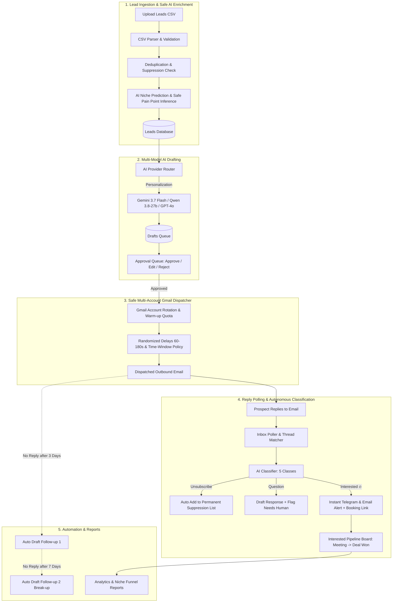

<p align="center">
  
</p>

<h1 align="center">Agentic Client Outreach OS</h1>

<p align="center">
  <b>Autonomous Multi-Provider AI Platform that Converts CSV Leads into Signed Clients</b><br/>
  Smart Lead Enrichment • Multi-Account Gmail Rotation • AI Classification • Instant Telegram Alerts • Automated Follow-ups
</p>

<p align="center">
  <a href="#-system-architecture--workflow"></a>
  <a href="#-quick-start-guide"></a>
  <a href="#-supported-ai-models"></a>
</p>

---

## 📌 Overview

**Agentic Outreach** is a complete, production-grade autonomous client handling system. It automates every step of modern B2B client acquisition:
1. **Intelligent CSV Ingestion**: Automatically cleans columns, predicts missing niches via AI without hallucinating personal contact info, checks suppression lists, and eliminates duplicates.
2. **Multi-Provider AI Personalization**: Generates crisp, highly relevant 90–150 word pitches referencing the lead’s real business pain points.
3. **Approval-First Queue (L0 Safety Mode)**: Review, edit, regenerate, or approve drafts individually or in bulk.
4. **Multi-Account Gmail Dispatcher**: Rotates across connected Gmail accounts with warm-up limits (20–30/day), randomized pauses (60–180s), and strict business-hour sending windows.
5. **AI Reply Classifier**: Inbound replies are polled and classified into 5 categories (`interested`, `question`, `not_interested`, `unsubscribe`, `out_of_office`).
6. **Instant Alerts**: Hot leads trigger instant notifications directly to Telegram and the owner's email with calendar booking links.
7. **Automated Follow-ups & Analytics**: Day-3 and Day-7 follow-up sequences, daily 8 PM digest, and visual niche conversion charts.

---

## 🏗️ System Architecture & Workflow



---

## ⚡ Supported AI Models

Configure models dynamically per task from **Settings & AI Routing** (`/settings`):

| Provider | Supported Models | Recommended Use |
|---|---|---|
| **Google Gemini** | `gemini-3.7-flash` (Newest), `gemini-2.0-flash`, `gemini-1.5-pro` | Ultra-fast lead personalization, niche prediction, and classification |
| **Grok / Groq** | `qwen/qwen3.8-27b` (Qwen Open Model), `grok-beta` | Direct, sharp, low-latency cold outreach drafts |
| **OpenAI** | `gpt-4o-mini`, `gpt-4o` | Nuanced conversational objection handling & reply drafting |

---

## 🚀 Quick Start Guide

### Step 1: Clone & Install Dependencies

```bash
git clone https://github.com/Nabab-Hub/mazaoutreach.git
cd mazaoutreach
npm install
```

### Step 2: Configure Environment Variables

Create your local `.env` file from the provided template:

```bash
cp example.env .env
```

Open `.env` and fill in your keys:

```env
# 1. Mode Configuration
NEXT_PUBLIC_DEMO_MODE=true        # Set to false when connecting live Firebase

# 2. AI Model API Keys
GEMINI_API_KEY=your_gemini_api_key_here
GROK_API_KEY=gsk_your_groq_or_xai_key_here      # Supports Groq (qwen3.8-27b) or xAI Grok
OPENAI_API_KEY=your_openai_api_key_here

# 3. Instant Alerts (Telegram & Owner Email)
TELEGRAM_BOT_TOKEN=your_telegram_bot_token
TELEGRAM_CHAT_ID=your_telegram_chat_id
OWNER_EMAIL=your_email@gmail.com
CALENDAR_BOOKING_LINK=https://calendly.com/your-username/15min
```

### Step 3: Run the Development Server

```bash
npm run dev
```

Open your browser at **[http://localhost:3000](http://localhost:3000)**.

---

## 📖 Step-by-Step Usage Walkthrough

### 1. Import Leads (`/import`)
- Download the sample CSV template or drag and drop your prospective client list.
- Keep the **AI Niche Prediction & Safe Auto-Fill** switch **ON**.
- The agent automatically validates email syntax, matches against existing records, infers missing niches (e.g., Club, Creator, Real Estate, Clinic), and flags operational bottlenecks without guessing private personal phone numbers or home addresses.

### 2. Review and Approve Drafts (`/approvals`)
- Navigate to the **Approval Queue**.
- Each card shows the prospect's business context, the AI-selected template angle, confidence score, and generated email.
- You can:
  - **Approve & Send**: Queues for immediate dispatch.
  - **Edit then Send**: Tweak wording in the inline editor.
  - **Regenerate with Instruction**: e.g., *"Make it shorter and emphasize mobile speed"*.
  - **Reject**: Drops the lead draft.
- Every manual edit is saved to **Learning Examples** to improve future generation accuracy.

### 3. Connect Gmail Accounts (`/accounts`)
- Connect one or more sender Gmail inboxes via OAuth.
- Set warm-up quotas (default: **20/day per account**).
- The platform automatically rotates across healthy accounts and adheres to configured sending windows (e.g., 10:00 to 17:00).

### 4. Manage Responses & Deals (`/pipeline`)
- When a prospect replies, the AI categorizes the intent:
  - **Interested**: Marked with flame badge 🔥, instantly notifies you on Telegram and via email.
  - **Question**: Drafts an answer; flags pricing commitments for human review.
  - **Unsubscribe**: Permanently adds to the suppression list.
- Drag and drop or transition cards across stages:
  `Contacted ➔ Replied ➔ Interested ➔ Discovery Call ➔ Deal Won 🎉`.

### 5. Monitor Reports & Deliverability (`/reports`)
- Track your overall conversion funnel: Total Sends, Reply Rate, and Interest Rate.
- Review performance breakdown by niche to identify your highest converting client vertical.

---

## 🔒 Deliverability & Compliance Standards

- **Strict Suppression Guard**: Recipient opt-out replies ("STOP", "unsubscribe") immediately cancel all future outreach and permanently block the email address across all connected inboxes.
- **Human-in-the-Loop (Level L0)**: Default autonomy ensures zero unverified outgoing emails are dispatched without explicit human sign-off.
- **AES-256 Token Encryption**: Google OAuth refresh tokens are encrypted at rest; credentials are never exposed to browser clients.
- **Google API Policy Compliant**: Adheres to the Google API Services User Data Policy and Limited Use standards.

---

## 📜 Legal & Support

- **Privacy Policy**: Visit [`/privacy`](http://localhost:3000/privacy)
- **Terms of Service**: Visit [`/terms`](http://localhost:3000/terms)
- **Repository**: [https://github.com/Nabab-Hub/mazaoutreach](https://github.com/Nabab-Hub/mazaoutreach)

© 2026 Agentic Outreach OS. Built for modern agency and freelance client acquisition.
