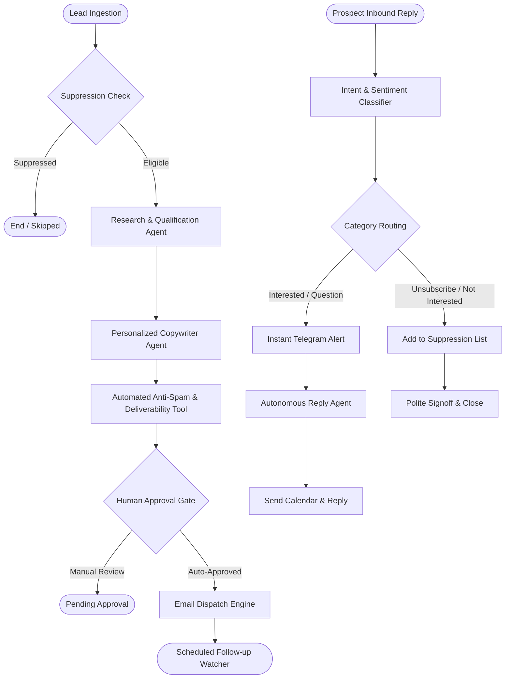

# 🤖 Agentic AI Client Outreach & Autonomous Reply Platform
### Built with LangChain, LangGraph, and LangSmith

A state-of-the-art Multi-Agent system for cold email personalization, follow-up sequencing, anti-spam deliverability protection, and autonomous prospect reply handling.

---

## 🌟 Key Architecture & Capabilities



### 1. Multi-Agent Ecosystem (LangGraph `StateGraph`)
- **Research & Qualification Agent (`research_agent.py`)**: Analyzes the prospect company, industry niche, website, and notes to detect 1-2 realistic software engineering bottlenecks.
- **Copywriter Agent (`copywriter_agent.py`)**: Drafts high-converting, 80-130 word, 1-to-1 cold emails strictly adhering to deliverability guidelines.
- **Follow-up Agent (`followup_agent.py`)**: Generates Follow-up #1 (3 days) and Follow-up #2 (7 days) citing previous conversation context and adding new value.
- **Inbound Reply Classifier Agent (`classifier_agent.py`)**: Classifies replies into `interested`, `question`, `meeting_booked`, `not_interested`, `unsubscribe`, `out_of_office`.
- **Autonomous Response Agent (`reply_agent.py`)**: Handles prospect queries, sends calendar booking links, or processes opt-outs politely.

### 2. High-Deliverability & Anti-Spam Standards
- **Top Unsubscribe Button**: Automatically injects a clean top unsubscribe header in both HTML and plain text versions, ensuring compliance with Google and Yahoo 2024/2025 inbox requirements.
- **Anti-Spam Filter Tool (`spam_checker.py`)**: Checks for spam-trigger keywords ("free", "guarantee", "100%", etc.), all-caps subject lines, and excessive punctuation.
- **Natural Typography**: Eliminates promotional card backgrounds, borders, and shadows that trigger marketing tabs.

### 3. LangSmith Observability & Tracing
- Full step-by-step tracing of prompt inputs, LLM outputs, token usage, latency, and agent node transitions.
- Enabled via:
  ```env
  LANGCHAIN_TRACING_V2=true
  LANGCHAIN_API_KEY=your_langsmith_api_key
  LANGCHAIN_PROJECT=client-handling-agentic-ai
  ```

---

## 🚀 Getting Started

### 1. Installation
Navigate into the `agentic-ai` directory and install dependencies:
```bash
cd "agentic-ai"
pip install -r requirements.txt
```

### 2. Environment Configuration
Copy `.env.example` to `.env` (or configure your parent `.env` file):
```bash
cp .env.example .env
```
Ensure you provide:
- `GEMINI_API_KEY` (or `OPENAI_API_KEY`)
- `LANGCHAIN_API_KEY` (for LangSmith tracing)
- `TELEGRAM_BOT_TOKEN` and `TELEGRAM_CHAT_ID` (for instant reply alerts)

### 3. CLI Testing Scripts

#### Run Outreach Workflow on a Lead:
```bash
python run_outreach.py
```
*Executes the full pipeline: Suppression check ➔ Research ➔ Copywriting ➔ Spam score check ➔ Formatting with top unsubscribe and Sk Ahidulla signature.*

#### Run Inbound Reply Handler:
```bash
python run_reply.py
```
*Simulates a prospect reply: Classification ➔ Telegram alert ➔ Autonomous response generation.*

### 4. Run the FastAPI Microservice
```bash
python server.py
```
Starts the API on `http://localhost:8000`:
- `GET /health` - Health check & LangSmith status
- `POST /api/v1/outreach` - Run cold outreach pipeline on a lead payload
- `POST /api/v1/reply` - Process inbound prospect replies

---

## 📁 Folder Structure

```
agentic-ai/
├── config.py                 # Configuration loader (.env, LangSmith, LLMs)
├── state.py                  # Pydantic & LangGraph state definitions
├── models.py                 # LangChain ChatModel factory (Gemini, OpenAI, Groq)
├── requirements.txt          # Python dependencies
├── .env.example              # Environment variables template
├── README.md                 # Complete documentation
│
├── tools/                    # LangChain Tools
│   ├── spam_checker.py       # Deliverability & spam risk analyzer
│   ├── telegram_tools.py     # Real-time Telegram alerting
│   ├── gmail_tools.py        # Top unsubscribe & signature email renderer
│   └── database_tools.py     # Suppression list & storage
│
├── agents/                   # Specialized AI Agents
│   ├── research_agent.py     # Lead & company analysis
│   ├── copywriter_agent.py   # Personalized 1-to-1 cold outreach drafter
│   ├── followup_agent.py     # Context-aware follow-up generator
│   ├── classifier_agent.py   # Inbound reply classifier
│   └── reply_agent.py        # Autonomous meeting & query respondent
│
├── graphs/                   # LangGraph Workflows
│   ├── outreach_graph.py     # Cold outreach & follow-up StateGraph
│   ├── reply_graph.py        # Reply processing StateGraph
│   └── orchestrator.py       # Unified multi-agent orchestrator
│
├── evaluation/               # LangSmith Evaluation
│   └── langsmith_eval.py     # Automated benchmark & tracing tests
│
├── run_outreach.py           # CLI runner for outreach workflow
├── run_reply.py              # CLI runner for inbound reply workflow
└── server.py                 # FastAPI microservice
```

---

## 👤 Profile & Defaults Configured
- **Freelancer**: Sk Ahidulla
- **Role**: Full-Stack Engineer & Automation Specialist
- **Contact**: +91 86097 20621 | skahidulla568@gmail.com
- **Website**: https://www.codingkamaza.in
- **YouTube**: https://youtube.com/@codingkamaza
- **Booking**: https://cal.com/skahidulla/10min

