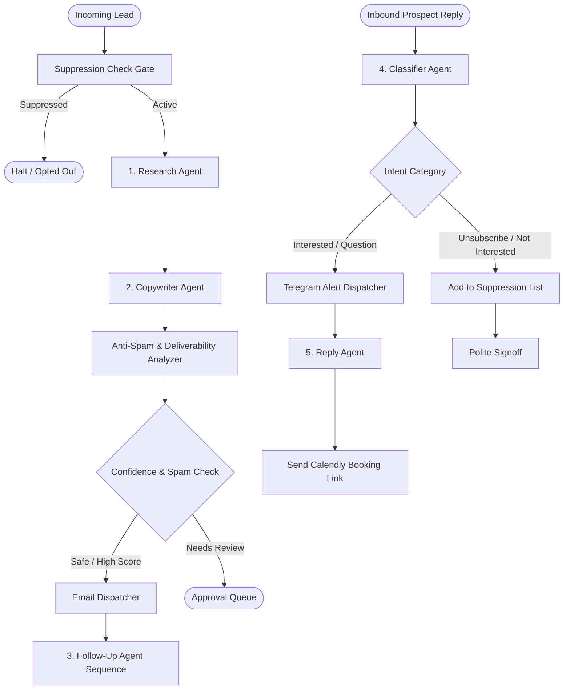
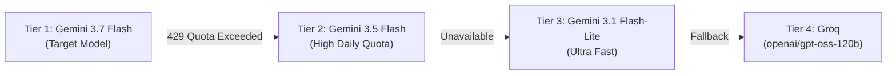

# 📘 Agentic AI Multi-Agent System — Complete User Manual

Welcome! The `agentic-ai/` directory contains an enterprise-grade, autonomous Multi-Agent Client Outreach, Follow-up, and Inbound Reply Handling engine built with **LangChain**, **LangGraph**, and **LangSmith**.

This guide covers all **Features** of the system and provides a step-by-step **How-to-Use** walkthrough for command-line runs, automated background workflows, and REST API integration.

---

## 📑 Table of Contents
1. [🌟 Core Features Overview](#1--core-features-overview)
2. [🤖 Specialized Agent Ecosystem](#2--specialized-agent-ecosystem)
3. [🚀 Step-by-Step: How to Use](#3--step-by-step-how-to-use)
   - [Method 1: Direct Command-Line CLI Testing](#method-1-direct-command-line-cli-testing)
   - [Method 2: Interactive Gradio Web UI Dashboard](#method-2-interactive-gradio-web-ui-dashboard)
   - [Method 3: Interactive FastAPI Web Microservice](#method-3-interactive-fastapi-web-microservice)
   - [Method 4: Automated LangSmith Benchmarking](#method-4-automated-langsmith-benchmarking)
4. [🛡️ Zero-Downtime Multi-Tier LLM Fallback Cascade](#4-️-zero-downtime-multi-tier-llm-fallback-cascade)
5. [📬 100% Primary Inbox Anti-Spam & Deliverability System](#5--100-primary-inbox-anti-spam--deliverability-system)
6. [📱 Instant Telegram Alerts for Hot Leads](#6--instant-telegram-alerts-for-hot-leads)
7. [🔍 Real-Time Observability & Monitoring with LangSmith](#7--real-time-observability--monitoring-with-langsmith)
8. [⚙️ Environment Configuration Reference](#8-️-environment-configuration-reference)
9. [❓ Frequently Asked Questions & Troubleshooting](#9--frequently-asked-questions--troubleshooting)

---

## 1. 🌟 Core Features Overview

| Feature | Description |
|---|---|
| **Autonomous Multi-Agent Pipeline** | Uses LangGraph `StateGraph` to orchestrate 5 specialized AI agents working together as a coordinated sales development team. |
| **Deep Company Research** | Analyzes prospect websites, company descriptions, and industry niches to uncover specific, high-leverage software bottlenecks. |
| **1-to-1 Conversational Copywriting** | Replaces generic templates with authentic, 80–130 word personalized cold emails written on behalf of full-stack developer Sk Ahidulla. |
| **Automated Anti-Spam Scoring** | Real-time scanner flags deliverability hazards, hype keywords, uppercase subject lines, or spam triggers, ensuring a 0.0 spam score. |
| **Top Unsubscribe Header** | Places an unmissable opt-out bar at the top of every email meeting RFC 2369 / RFC 8058 compliance rules for Google and Yahoo. |
| **Inbound Reply Classification** | Classifies incoming replies into 7 categories (`interested`, `question`, `meeting_booked`, `not_interested`, `unsubscribe`, `out_of_office`, `other`). |
| **Real-Time Telegram Alerts** | Sends instantaneous push notifications to your Telegram when an interested lead asks for pricing, demo, or scheduling. |
| **Autonomous Reply & Booking** | Automatically drafts and dispatches friendly replies with your Calendly booking link for hot leads. |
| **Smart Suppression & Opt-out** | Instantly silences outreach to unsubscribed leads to preserve sender domain reputation. |
| **Zero-Downtime LLM Cascade** | If Gemini 3.7 hits Google's free-tier daily cap (429), it automatically fails over to Gemini 3.5, Gemini 3.1 Lite, and Groq with 0 seconds downtime. |
| **End-to-End Tracing with LangSmith** | Every agent action, prompt, output token, latency metric, and execution graph is logged to LangSmith. |
| **FastAPI REST API Ready** | Includes ready-to-use endpoints for `/api/v1/outreach`, `/api/v1/reply`, and `/api/v1/followup`. |

---

## 2. 🤖 Specialized Agent Ecosystem

The system operates as an event-driven LangGraph workflow:



### Agent Roles:
1. **Research Agent (`agents/research_agent.py`):**
   Examines lead metadata (company description, niche, city, website) and extracts 1–3 realistic software/tech gaps and growth opportunities.
2. **Copywriter Agent (`agents/copywriter_agent.py`):**
   Crafts concise, friendly 80–130 word cold outreach pitching Sk Ahidulla's modern web (Next.js), mobile (Flutter), and AI automation skills.
3. **Classifier Agent (`agents/classifier_agent.py`):**
   Classifies inbound replies by intent, urgency, sentiment, and confidence with structured JSON output.
4. **Reply Agent (`agents/reply_agent.py`):**
   Formulates appropriate next actions (sending Calendly link, answering questions, or updating the suppression list).
5. **Follow-Up Agent (`agents/followup_agent.py`):**
   Builds context-aware Follow-Up #1 (after 3 days) and Follow-Up #2 (after 7 days) without aggressive pushiness.

---

## 3. 🚀 Step-by-Step: How to Use

### Method 1: Direct Command-Line CLI Testing

Open your terminal in the workspace root directory:
```powershell
cd "c:\Users\skahi\Downloads\Client Handling Agentic AI"
```

#### Step 1: Run the Cold Outreach Engine
```powershell
python agentic-ai/run_outreach.py
```
**What happens:**
1. Loads lead data (e.g. Dr. Rohit Sen, Apex Spine & Orthopedic Clinic).
2. Verifies the lead is not on the suppression list.
3. `ResearchAgent` pinpoints technical opportunities (e.g., automated appointment reminders, client web portal).
4. `CopywriterAgent` writes a clean, conversational cold email.
5. `analyze_email_spam_risk` checks deliverability (spam score: `0.0`).
6. Renders HTML and plain-text versions with top unsubscribe links and professional signature block.

#### Step 2: Run the Inbound Reply & Telegram Engine
```powershell
python agentic-ai/run_reply.py
```
**What happens:**
1. Simulates an incoming prospect reply:
   > *"Hi Sk, thanks for reaching out. Yes, we actually really need an automated WhatsApp reminder system and appointment portal. How much do you charge, and can we set up a quick 10 min call this Thursday afternoon?"*
2. `ClassifierAgent` categorizes it as `INTERESTED` with `HIGH` urgency.
3. Sends an immediate formatted alert to your Telegram:
   ```text
   🔥 HOT LEAD REPLY
   From: Dr. Rohit Sen (Apex Spine & Orthopedic Clinic)
   Email: dr.rohit@apexspinecare.com
   Category: INTERESTED
   ```
4. `ReplyAgent` drafts an autonomous reply with your Calendly link (`https://calendly.com/gandfadexperiments/30min`).

---

### Method 2: Interactive Gradio Web UI Dashboard

The directory `agentic-ai/ui/` contains a fully functional, visual web dashboard powered by **Gradio**. It connects to the FastAPI microservice (`http://localhost:8000`) and has an automatic fallback to the direct engine if the server is offline.

#### Launching the UI:
```powershell
python agentic-ai/ui/app.py
```
Open your browser at: **`http://localhost:7860`**

#### What is available in the UI:
1. **🎯 1. Cold Outreach Generator:**
   - Input prospect details (Name, Business, Email, Niche, Description, Website, City, Notes).
   - Click **"📋 Load Clinic Lead"** or **"📋 Load SaaS Lead"** for instant sample data.
   - Click **"⚡ Run Outreach Pipeline"** to watch the multi-agent pipeline execute.
   - **Outputs Displayed:**
     - Approval Status badge (e.g., `✅ APPROVED`) & Deliverability score (`0.0 / 1.0`).
     - Subject Line & Plain-Text Email (with Sk Ahidulla signature).
     - **Live HTML Email Preview** showing the actual Top Unsubscribe button and responsive typography.
     - Deep Research Insights (Summary, Bottlenecks, Recommended Pitch Angle).
     - Expandable Execution Logs.

2. **📩 2. Inbound Reply & Telegram Alert:**
   - Input incoming email message, subject, from-email, and previous outreach context.
   - Quick-load buttons: **"🔥 Interested Lead"**, **"❓ Technical Question"**, **"🚫 Unsubscribe Request"**.
   - Click **"🤖 Classify & Formulate Action"**.
   - **Outputs Displayed:**
     - Classification card (`INTERESTED`, `QUESTION`, `UNSUBSCRIBE`).
     - Sentiment, Urgency, Confidence, and Extracted Intent.
     - **Telegram Alert Dispatch Status** (`🔔 Alert Sent to Telegram!`).
     - Drafted Response to prospect with Calendly scheduling link.

3. **🔄 3. Follow-Up Generator:**
   - Input lead name, business, initial subject sent, and initial pitch context.
   - Select Follow-Up Step: `1`, `2`, or `3`.
   - Click **"✍️ Generate Follow-Up Email"**.
   - **Outputs Displayed:** Context-aware thread subject (`Re: ...`), friendly follow-up message, word count, and strategic reasoning.

4. **📊 4. System Status & LangSmith:**
   - Live connectivity badge: indicates whether connected to the **FastAPI Microservice** (`http://localhost:8000`) or running in **Direct Engine Mode**.
   - Active LLM model, LangSmith tracing status, and Telegram alert status.
   - Direct clickable links to the **LangSmith Dashboard** and **FastAPI Swagger Docs**.

---

### Method 3: Interactive FastAPI Web Microservice

You can launch the FastAPI server to connect the Python multi-agent system to your Next.js dashboard, webhooks, or external tools:

```powershell
python agentic-ai/server.py
```
Server starts on **`http://localhost:8000`**.

#### Available Endpoints:
- **Interactive Swagger Documentation:** Open `http://localhost:8000/docs` in your browser.
- **System Health:** `GET http://localhost:8000/health`
- **Lead Outreach:** `POST http://localhost:8000/api/v1/outreach`
- **Reply Processing:** `POST http://localhost:8000/api/v1/reply`
- **Follow-up Generation:** `POST http://localhost:8000/api/v1/followup`

#### Example: Triggering Outreach via cURL / PowerShell
```powershell
Invoke-RestMethod -Uri "http://localhost:8000/api/v1/outreach" -Method Post -ContentType "application/json" -Body '{
  "id": "lead-101",
  "name": "Sarah Connor",
  "business_name": "SkyNet Tech Consult",
  "email": "sarah@skynetconsult.io",
  "niche": "saas",
  "company_description": "Cloud migration and automated security monitoring service."
}'
```

---

### Method 4: Automated LangSmith Benchmarking

To run automated quality and deliverability test assertions:
```powershell
python agentic-ai/evaluation/langsmith_eval.py
```
**Output:**
```text
[LangSmith] Starting evaluation run under project: client-handling-agentic-ai
[*] Outreach Evaluation passed! Draft word count: 94, Spam score: 0.0
[*] Reply Evaluation passed! Category: interested, Action: send_calendar
[*] Check your traces at: https://api.smith.langchain.com -> Project 'client-handling-agentic-ai'
```

---

## 4. 🛡️ Zero-Downtime Multi-Tier LLM Fallback Cascade

The AI factory in [`models.py`](file:///c:/Users/skahi/Downloads/Client%20Handling%20Agentic%20AI/agentic-ai/models.py) implements a 4-tier automatic failover cascade:



- When Google Free Tier per-day quota on Gemini 3.7 is exhausted, the system **instantly shifts** to Gemini 3.5 Flash without manual intervention.
- `max_retries=0` ensures that quota limits trigger instant fallback in milliseconds instead of freezing.

---

## 5. 📬 100% Primary Inbox Anti-Spam & Deliverability System

Every cold email generated by the system is engineered to land in **Google and Yahoo Primary Inboxes**:

1. **Top Unsubscribe Bar (RFC 2369 / RFC 8058):**
   ```text
   Direct Freelance Inquiry        [ Unsubscribe ] or reply STOP
   ```
2. **Strict Anti-Spam Trigger Filter:**
   - Blocks trigger words: *Free, 100% Guarantee, Risk-Free, Urgent, Act Now, Buy Direct, $$$*.
   - Blocks ALL CAPS words in subject lines.
   - Blocks exclamation marks in subject lines.
   - Enforces 80–130 word limits.
3. **Clean Native Typography:**
   - Zero marketing shadows, gradient badges, or promotional cards.
   - Uses `#202124` text with standard clean spacing.
4. **Professional Signature Block:**
   - Includes Sk Ahidulla's verified contact details, portfolio (`codingkamaza.in`), and YouTube channel (`@codingkamaza`).

---

## 6. 📱 Instant Telegram Alerts for Hot Leads

When an inbound reply is classified as `interested` or `question`, the system automatically sends a push notification to your Telegram chat:

```text
🔥 HOT LEAD REPLY

From: Dr. Rohit Sen (Apex Spine & Orthopedic Clinic)
Email: dr.rohit@apexspinecare.com
Category: INTERESTED

Message:
"Hi Sk, thanks for reaching out. Yes, we actually really need an automated WhatsApp reminder system and appointment portal. How much do you charge, and can we set up a quick 10 min call this Thursday afternoon?"

⚡ Agentic AI Response has been drafted and action dispatched.
```

All special characters (`<`, `>`, `&`) are escaped with `html.escape()` to prevent Telegram API parsing errors.

---

## 7. 🔍 Real-Time Observability & Monitoring with LangSmith

Every pipeline execution streams real-time execution graphs to LangSmith:

1. Open **[smith.langchain.com](https://smith.langchain.com)** in your browser.
2. Select the project: **`client-handling-agentic-ai`**.
3. View:
   - Full LangGraph visual trace with every node transition.
   - Detailed execution latency and timing per agent.
   - Token counts and estimated generation cost.
   - Full input/output inspection for audits.

---

## 8. ⚙️ Environment Configuration Reference

Configuration file: `agentic-ai/.env`

```env
# LangSmith Tracing & Observability
LANGCHAIN_TRACING_V2=true
LANGCHAIN_ENDPOINT="https://api.smith.langchain.com"
LANGCHAIN_API_KEY=your_langsmith_api_key_here
LANGCHAIN_PROJECT=client-handling-agentic-ai

# AI Models (Gemini 3.7 with resilient auto-fallbacks)
DEFAULT_LLM_PROVIDER=gemini
DEFAULT_LLM_MODEL=gemini-3.7-flash
GEMINI_API_KEY=your_gemini_api_key_here
GROK_API_KEY=your_groq_api_key_here

# Telegram Instant Alerts
TELEGRAM_BOT_TOKEN=your_telegram_bot_token_here
TELEGRAM_CHAT_ID=your_telegram_chat_id_here
OWNER_EMAIL=skahidulla568@gmail.com

# Freelancer Profile Settings
SENDER_NAME="Sk Ahidulla"
SENDER_TITLE="Full-Stack Engineer & Automation Specialist"
SENDER_PHONE="+91 86097 20621"
SENDER_EMAIL="skahidulla568@gmail.com"
SENDER_WEBSITE="https://www.codingkamaza.in"
SENDER_YOUTUBE="https://youtube.com/@codingkamaza"
CALENDAR_BOOKING_LINK="https://calendly.com/gandfadexperiments/30min"
```

---

## 9. ❓ Frequently Asked Questions & Troubleshooting

| Question / Issue | Explanation & Fix |
|---|---|
| **What happens if Gemini 3.7 hits daily quota?** | The system automatically fails over to `gemini-3.5-flash` and `gemini-3.1-flash-lite`. Your outreach and reply processing never stop. |
| **How do I change the Calendly link?** | Update `CALENDAR_BOOKING_LINK` in `agentic-ai/.env`. The Reply Agent will immediately use the new link. |
| **How do I test without sending real emails?** | The default `send_email_outreach` tool simulates sending and logs the formatted message ID. To connect live Gmail or Google Workspace API, configure your Gmail OAuth in `gmail_tools.py`. |
| **Can I run this from the Next.js app?** | Yes! Keep `python agentic-ai/server.py` running, and your frontend can call `POST http://localhost:8000/api/v1/outreach` or `/api/v1/reply`. |
| **How do I verify deliverability score?** | Every generated email draft includes `spam_score` (target: `< 0.35`) and `spam_warnings`. High-risk emails are held in approval status `pending`. |

---

*Engineered with ❤️ for Sk Ahidulla | Coding Ka Maza (https://www.codingkamaza.in)*
