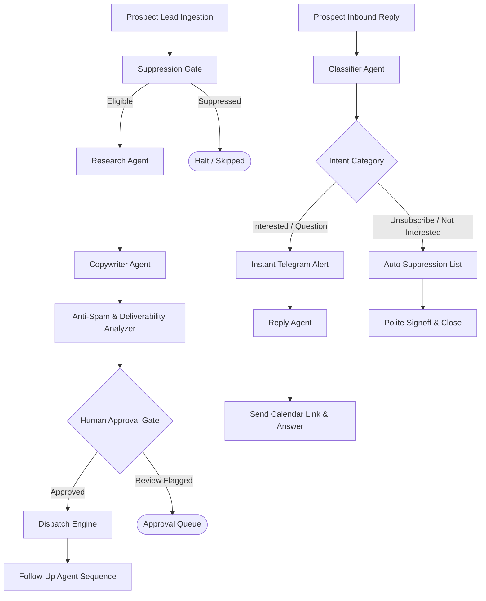

# 📘 Agentic AI Multi-Agent System — Complete User Manual

Welcome! This directory (`agentic-ai/`) contains a production-ready, autonomous Multi-Agent Client Outreach and Inbound Reply Handling engine built with **LangChain**, **LangGraph**, and **LangSmith**.

---

## 📑 Table of Contents
1. [System Architecture & Agent Roles](#1-system-architecture--agent-roles)
2. [Environment Setup & Configuration](#2-environment-setup--configuration)
3. [Running the Agents via Command Line (CLI)](#3-running-the-agents-via-command-line-cli)
4. [Live Tracing & Observability in LangSmith](#4-live-tracing--observability-in-langsmith)
5. [Telegram Alerts & Autonomous Reply Workflows](#5-telegram-alerts--autonomous-reply-workflows)
6. [Anti-Spam Deliverability & Top Unsubscribe System](#6-anti-spam-deliverability--top-unsubscribe-system)
7. [FastAPI Microservice Integration](#7-fastapi-microservice-integration)
8. [Troubleshooting & Common FAQs](#8-troubleshooting--common-faqs)

---

## 1. System Architecture & Agent Roles

The system is coordinated by LangGraph's `StateGraph`, connecting five specialized agents into an event-driven pipeline:



### Specialized Agents Overview:
1. **Research Agent (`agents/research_agent.py`):**
   - Analyzes prospect business name, niche, company description, and website.
   - Identifies high-value software engineering pain points (e.g., manual customer onboarding, lack of automated booking, legacy tech stack) tailored to Sk Ahidulla's freelance services.
2. **Copywriter Agent (`agents/copywriter_agent.py`):**
   - Writes concise, 80–130 word, 1-to-1 natural cold emails on behalf of Sk Ahidulla (Full-Stack Engineer & Automation Specialist).
   - Strictly enforces anti-spam heuristics (zero hype words, no exclamation marks, conversational subject line).
3. **Follow-Up Agent (`agents/followup_agent.py`):**
   - Sequences Follow-Up #1 (after 3 days) and Follow-Up #2 (after 7 days).
   - Politely references the previous outreach context, introduces a relevant case study, and provides a low-friction invitation for a 10-minute call.
4. **Classifier Agent (`agents/classifier_agent.py`):**
   - Analyzes incoming client replies and extracts intent, sentiment, urgency, and categorization (`interested`, `question`, `meeting_booked`, `not_interested`, `unsubscribe`, `out_of_office`).
5. **Reply Agent (`agents/reply_agent.py`):**
   - When a prospect is interested, generates an enthusiastic response with the Calendly booking link and triggers a real-time Telegram alert.
   - When an opt-out is detected, automatically adds the email to the suppression list and confirms removal politely.

---

## 2. Environment Setup & Configuration

File location: `agentic-ai/.env`

Your environment is pre-configured with the following settings:
```env
# LangSmith Tracing & Observability
LANGCHAIN_TRACING_V2=true
LANGCHAIN_ENDPOINT="https://api.smith.langchain.com"
LANGCHAIN_API_KEY=your_langsmith_api_key_here
LANGCHAIN_PROJECT=client-handling-agentic-ai

# AI Models (Gemini 3.7 Flash with resilient auto-fallback to 3.8)
DEFAULT_LLM_PROVIDER=gemini
DEFAULT_LLM_MODEL=gemini-3.7-flash
GEMINI_API_KEY=your_gemini_api_key_here

# Telegram Instant Alerts
TELEGRAM_BOT_TOKEN=your_telegram_bot_token_here
TELEGRAM_CHAT_ID=your_telegram_chat_id_here

# Freelancer Profile & Business Defaults
SENDER_NAME="Sk Ahidulla"
SENDER_TITLE="Full-Stack Engineer & Automation Specialist"
SENDER_PHONE="+91 86097 20621"
SENDER_EMAIL="skahidulla568@gmail.com"
SENDER_WEBSITE="https://www.codingkamaza.in"
SENDER_YOUTUBE="https://youtube.com/@codingkamaza"
CALENDAR_BOOKING_LINK="https://calendly.com/gandfadexperiments/30min"
```

---

## 3. Running the Agents via Command Line (CLI)

From your terminal in the workspace root directory (`Client Handling Agentic AI`):

### A. Test Cold Outreach Pipeline:
```powershell
python agentic-ai/run_outreach.py
```
**What happens:**
1. Checks if the lead is in the suppression list.
2. `ResearchAgent` inspects the company description and finds technical pain points.
3. `CopywriterAgent` drafts an 80–130 word personalized email.
4. `analyze_email_spam_risk` validates a deliverability score of `0.0`.
5. Formats the email with a **Top Unsubscribe Button** and Sk Ahidulla's signature block.
6. Auto-approves and simulates sending.

### B. Test Inbound Reply Handler & Telegram Alert:
```powershell
python agentic-ai/run_reply.py
```
**What happens:**
1. Simulates an incoming email reply from an interested prospect.
2. `ClassifierAgent` categorizes it as `INTERESTED` with high urgency.
3. Dispatches an instant real-time notification to your **Telegram Bot**.
4. `ReplyAgent` generates an autonomous response including your Calendly link (`https://calendly.com/gandfadexperiments/30min`).

### C. Run LangSmith Automated Benchmark Evaluation:
```powershell
python agentic-ai/evaluation/langsmith_eval.py
```

---

## 4. Live Tracing & Observability in LangSmith

Every execution automatically streams real-time traces to your LangSmith dashboard:

1. Open your browser and navigate to: **[smith.langchain.com](https://smith.langchain.com)**
2. Sign in with your GitHub or Google account.
3. Select the **`client-handling-agentic-ai`** project.
4. Here you can inspect:
   - Full visual **StateGraph execution flow** with every node transition.
   - Exact prompts and raw LLM responses.
   - Token usage breakdown and cost estimation.
   - Latency metrics per agent node.

---

## 5. Telegram Alerts & Autonomous Reply Workflows

When prospects respond to your outreach, the system handles them autonomously based on intent:

| Category | System Behavior | Telegram Alert? |
|---|---|:---:|
| **`interested`** | Generates friendly response with Calendly booking link | ✅ **Yes (Instant Alert)** |
| **`question`** | Answers technical questions and offers a 10-minute discovery call | ✅ **Yes (Instant Alert)** |
| **`unsubscribe`** | Adds email to suppression list and sends a polite opt-out confirmation | ❌ No alert needed |
| **`not_interested`** | Sends a courteous closing note wishing them success | ❌ No alert needed |
| **`out_of_office`** | Snoozes conversation until prospect returns | ❌ No alert needed |

---

## 6. Anti-Spam Deliverability & Top Unsubscribe System

To ensure emails land strictly in Google/Yahoo **Primary Inbox** rather than Spam or Promotions:

1. **Top Unsubscribe Header:**
   The email opens with an unmissable top unsubscribe bar:
   ```text
   Direct Freelance Inquiry        [ Unsubscribe ] or reply STOP
   ```
   This satisfies modern email deliverability RFC rules (RFC 2369 & RFC 8058) without forcing recipients to scroll.
2. **Natural 1-to-1 Typography:**
   All heavy promotional card styling, CSS drop-shadows, and marketing frames have been eliminated in favor of clean `#202124` native Gmail typography.
3. **Automated Spam Keyword Filtering:**
   The `spam_checker.py` tool scores every draft, blocking hype words like "Free", "100% Guarantee", "Urgent", or ALL CAPS subject lines.

---

## 7. FastAPI Microservice Integration

You can run the agent engine as a standalone REST API microservice:

```powershell
python agentic-ai/server.py
```
The server will start on port `8000`:
- **Health Check:** `GET http://localhost:8000/health`
- **Outreach API:** `POST http://localhost:8000/api/v1/outreach`
- **Reply Handler API:** `POST http://localhost:8000/api/v1/reply`

### Example Request (`POST /api/v1/outreach`):
```json
{
  "id": "lead-1",
  "name": "Dr. Rohit Sen",
  "business_name": "Apex Spine Care",
  "email": "dr.rohit@apexspinecare.com",
  "niche": "clinic",
  "company_description": "Orthopedic clinic seeking automated WhatsApp appointment reminders and web portal."
}
```

---

## 8. Troubleshooting & Common FAQs

| Issue | Root Cause | Solution |
|---|---|---|
| `ModuleNotFoundError` | Missing Python package | Run `pip install -r agentic-ai/requirements.txt` |
| `Telegram Alert failed` | Invalid Bot Token or Chat ID | Verify `TELEGRAM_BOT_TOKEN` & `TELEGRAM_CHAT_ID` in `.env` |
| `503 Unavailable (Gemini)` | Temporary load on Gemini 3.7 endpoint | The system automatically fails over to `gemini-3.8-flash` via `with_fallbacks()` |
| `UnicodeEncodeError on Windows` | Default CP1252 console encoding | Handled automatically by `_setup_path.py` with UTF-8 reconfigure |

---

*Authored by: Sk Ahidulla | Coding Ka Maza (https://www.codingkamaza.in)*
