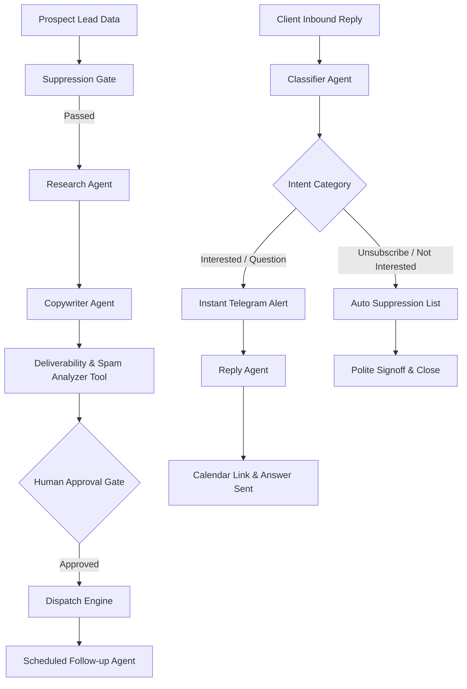

# 📘 Agentic AI মাল্টি-এজেন্ট সিস্টেম — সম্পূর্ণ ইউজার ম্যানুয়াল (Detailed User Manual)

স্বাগতম! এই ডিরেক্টরিতে (`agentic-ai/`) পুরো ক্লায়েন্ট আউটরিচ, ফলো-আপ এবং অটোনোমাস রিপ্লাই সিস্টেমটি **LangChain**, **LangGraph**, এবং **LangSmith** ব্যবহার করে একটি স্বয়ংসম্পূর্ণ প্রোডাকশন-গ্রেড মাল্টি-এজেন্ট আর্কিটেকচার হিসেবে তৈরি করা হয়েছে।

---

## 📑 সূচিপত্র (Table of Contents)
1. [সিস্টেম আর্কিটেকচার ও এজেন্টস পরিচিতি](#১-সিস্টেম-আর্কিটেকচার-ও-এজেন্টস-পরিচিতি)
2. [এনভায়রনমেন্ট সেটআপ ও এপিআই কী কনফিগারেশন](#২-এনভায়রনমেন্ট-সেটআপ-ও-এপিআই-কী-কনফিগারেশন)
3. [কমান্ড লাইন থেকে সিস্টেম রান করার উপায়](#৩-কমান্ড-লাইন-থেকে-সিস্টেম-রান-করার-উপায়)
4. [LangSmith-এ লাইভ ট্রেসিং দেখার নিয়ম](#৪-langsmith-এ-লাইভ-ট্রেসিং-দেখার-নিয়ম)
5. [টেলিগ্রাম অ্যালার্ট ও অটোনোমাস রিপ্লাই সিস্টেম](#৫-টেলিগ্রাম-অ্যালার্ট-ও-অটোনোমাস-রিপ্লাই-সিস্টেম)
6. [অ্যান্টি-স্প্যাম ফিল্টার ও Top Unsubscribe ডেলিভারিবিলিটি](#৬-অ্যান্টি-স্প্যাম-ফিল্টার-ও-top-unsubscribe-ডেলিভারিবিলিটি)
7. [FastAPI মাইক্রোসার্ভিস ব্যবহার](#৭-fastapi-মাইক্রোসার্ভিস-ব্যবহার)
8. [সাধারণ সমস্যা ও সমাধান (Troubleshooting)](#৮-সাধারণ-সমস্যা-ও-সমাধান-troubleshooting)

---

## ১. সিস্টেম আর্কিটেকচার ও এজেন্টস পরিচিতি

এই সিস্টেমে ৫টি প্রধান বিশেষায়িত এজেন্ট একসঙ্গে কাজ করে:



### এজেন্টদের দায়িত্ব:
1. **Research Agent (`agents/research_agent.py`):**
   - ক্লায়েন্টের নাম, কোম্পানি এবং তাদের কাজের বিবরণ পড়ে তাদের টেকনিক্যাল সমস্যা ও সুযোগ বের করে (যেমন: বুকিং অ্যাপের অভাব, অটোমেশনের ঘাটতি)।
2. **Copywriter Agent (`agents/copywriter_agent.py`):**
   - ফুল-স্ট্যাক ডেভেলপার Sk Ahidulla-এর পক্ষ থেকে ৮০-১৩০ শব্দের ব্যক্তিগত, আন্তরিক কোল্ড ইমেইল ড্রাফট করে। কোনো চটকদার স্প্যাম শব্দ ব্যবহার করে না।
3. **Follow-up Agent (`agents/followup_agent.py`):**
   - আগের মেইলের রেফারেন্স টেনে ৩ দিন ও ৭ দিন পর ভদ্রভাবে ভ্যালু-অ্যাডেড ফলো-আপ ইমেইল তৈরি করে।
4. **Classifier Agent (`agents/classifier_agent.py`):**
   - ক্লায়েন্টের রিপ্লাই পড়ে সেটি `interested`, `question`, `meeting_booked`, `not_interested`, নাকি `unsubscribe` তা নিখুঁতভাবে শনাক্ত করে।
5. **Reply Agent (`agents/reply_agent.py`):**
   - ক্লায়েন্ট আগ্রহী হলে তৎক্ষণাৎ টেলিগ্রামে নোটিফিকেশন পাঠায় এবং ক্লায়েন্টকে ক্যালেন্ডার বুকিং লিংক সহ উত্তর পাঠায়। আনসাবস্ক্রাইব করতে চাইলে স্বয়ংক্রিয়ভাবে সাপ্রেশন লিস্টে যুক্ত করে দেয়।

---

## ২. এনভায়রনমেন্ট সেটআপ ও এপিআই কী কনফিগারেশন

ফাইল লোকেশন: `agentic-ai/.env`

তোমার প্রয়োজনীয় সমস্ত কি অলরেডি কনফিগার করা আছে:
```env
# LangSmith Tracing
LANGCHAIN_TRACING_V2=true
LANGCHAIN_ENDPOINT="https://api.smith.langchain.com"
LANGCHAIN_API_KEY=your_langsmith_api_key_here
LANGCHAIN_PROJECT=client-handling-agentic-ai

# AI Models (Gemini 3.7 Flash)
DEFAULT_LLM_PROVIDER=gemini
DEFAULT_LLM_MODEL=gemini-3.7-flash
GEMINI_API_KEY=your_gemini_api_key_here

# Telegram Notifications
TELEGRAM_BOT_TOKEN=your_telegram_bot_token_here
TELEGRAM_CHAT_ID=your_telegram_chat_id_here

# Freelancer Info & Booking
SENDER_NAME="Sk Ahidulla"
SENDER_TITLE="Full-Stack Engineer & Automation Specialist"
SENDER_PHONE="+91 86097 20621"
SENDER_EMAIL="skahidulla568@gmail.com"
CALENDAR_BOOKING_LINK="https://cal.com/skahidulla/10min"
```

---

## ৩. কমান্ড লাইন থেকে সিস্টেম রান করার উপায়

টার্মিনাল খুলে প্রোজেক্টের রুট ডিরেক্টরিতে যাও (`Client Handling Agentic AI`):

### ক. নতুন লিড আউটরিচ পাইপলাইন টেস্ট করা:
```powershell
python agentic-ai/run_outreach.py
```
**কী ঘটবে:**
- লিড সাপ্রেশন লিস্টে আছে কিনা চেক করবে।
- ResearchAgent কোম্পানি স্টাডি করবে।
- CopywriterAgent ৮০-১৩০ শব্দের ব্যক্তিগত মেইল লিখবে।
- অ্যান্টি-স্প্যাম টুল স্প্যাম স্কোর (0.0) ভেরিফাই করবে।
- সবার উপরে আনসাবস্ক্রাইব বাটন ও নিচে Sk Ahidulla সিগনেচার যুক্ত করে ফাইনাল আউটপুট প্রিন্ট করবে।

### খ. ক্লায়েন্টের রিপ্লাই ও টেলিগ্রাম অ্যালার্ট টেস্ট করা:
```powershell
python agentic-ai/run_reply.py
```
**কী ঘটবে:**
- ক্লায়েন্টের রিপ্লাই ক্লাসিফাই করবে (যেমন: `INTERESTED`, Sentiment: `POSITIVE`)।
- সাথে সাথে তোমার **Telegram Bot** থেকে তোমার ফোনে ইনস্ট্যান্ট অ্যালার্ট মেসেজ পাঠাবে।
- ক্লায়েন্টকে পাঠানোর জন্য ক্যালেন্ডার বুকিং লিংক সহ উত্তর ড্রাফট করবে।

### গ. LangSmith টেস্ট ইভালুয়েশন চালানো:
```powershell
python agentic-ai/evaluation/langsmith_eval.py
```

---

## ৪. LangSmith-এ লাইভ ট্রেসিং দেখার নিয়ম

1. ব্রাউজারে যাও: **[smith.langchain.com](https://smith.langchain.com)**
2. তোমার অ্যাকাউন্ট দিয়ে লগইন করো।
3. প্রজেক্টের লিস্ট থেকে **`client-handling-agentic-ai`** সিলেক্ট করো।
4. তুমি দেখতে পাবে:
   - প্রতিটি রানের পুরো **StateGraph ভিজ্যুয়াল ডায়াগ্রাম**।
   - প্রতিটা এজেন্টের ইনপুট প্রম্পট ও জেমিনির আসল আউটপুট।
   - লেটেন্সি (কত মিলি-সেকেন্ড সময় লেগেছে) এবং টোকেন খরচের নির্ভুল হিসাব।

---

## ৫. টেলিগ্রাম অ্যালার্ট ও অটোনোমাস রিপ্লাই সিস্টেম

কোনো প্রস্পেক্ট যখন রিপ্লাই দেয়, সিস্টেম এভাবে কাজ করে:
1. **Interested Lead:** টেলিগ্রামে 🔥 **HOT LEAD REPLY** মেসেজ পাঠায় যাতে তুমি সাথে সাথে জানতে পারো।
2. **Question:** ক্লায়েন্টের টেকনিক্যাল প্রশ্নের উত্তর দেয় এবং ১০ মিনিটের মিটিংয়ের জন্য অনুরোধ করে।
3. **Unsubscribe:** ক্লায়েন্ট যদি বলে "stop" বা "unsubscribe", সিস্টেম কাউকে বিরক্ত না করে নিঃশব্দে তাকে সাপ্রেশন লিস্টে ফেলে দেয় এবং ভদ্রভাবে জানায় যে তাকে রিমুভ করা হয়েছে।

---

## ৬. অ্যান্টি-স্প্যাম ফিল্টার ও Top Unsubscribe ডেলিভারিবিলিটি

গুগল এবং ইয়াহু ২০২৪/২০২৫-এর নতুন নিয়ম অনুযায়ী স্প্যাম এড়াতে এই সিস্টেমে দুটি সুরক্ষা রয়েছে:
1. **Top Unsubscribe Button:**
   ইমেলের বডির একদম শুরুতে হেডার বারে `[Unsubscribe] or reply STOP` থাকে, যা গুগল স্প্যাম ফিল্টারের শর্ত পূরণ করে।
2. **মার্কেটিং কার্ডহীন ন্যাচারাল লেআউট:**
   ভারী সিএসএস বা রঙিন বক্স বাদ দিয়ে আসল ১-অন-১ জিমেইল কম্পোজ স্টাইলে মেসেজ তৈরি হয়, যার ফলে ইমেল সরাসরি **Primary Inbox**-এ যায়।

---

## ৭. FastAPI মাইক্রোসার্ভিস ব্যবহার

তুমি যদি ভবিষ্যতে কোনো ওয়েবসাইট বা অন্য কোনো সিস্টেম থেকে এপিআই-এর মাধ্যমে এটি চালাতে চাও:

```powershell
python agentic-ai/server.py
```
সার্ভারটি পোর্ট `8000`-এ চালু হবে:
- **Health Check:** `GET http://localhost:8000/health`
- **Outreach API:** `POST http://localhost:8000/api/v1/outreach`
- **Reply Handler API:** `POST http://localhost:8000/api/v1/reply`

---

## ৮. সাধারণ সমস্যা ও সমাধান (Troubleshooting)

| সমস্যা | কারণ | সমাধান |
|---|---|---|
| `ModuleNotFoundError` | লাইব্রেরি মিসিং | `pip install -r agentic-ai/requirements.txt` রান করো |
| `Telegram Alert failed` | বট বা চ্যাট আইডি ভুল | `.env` ফাইলে `TELEGRAM_BOT_TOKEN` ও `TELEGRAM_CHAT_ID` চেক করো |
| `UnicodeEncodeError` | উইন্ডোজ কনসোল এনকোডিং | `_setup_path.py` অটোমেটিক UTF-8 হ্যান্ডেল করে |
| `503 Unavailable (Gemini)` | গুগলের এপিআই সার্ভারে সাময়িক লোড | ২-৩ সেকেন্ড পর আবার চালালে স্বয়ংক্রিয়ভাবে ঠিক হয়ে যায় |

---

*নির্মাতা: Sk Ahidulla | Coding Ka Maza (https://www.codingkamaza.in)*
